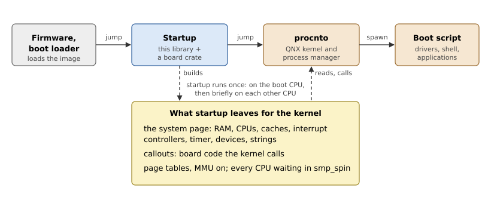

# What Startup Does

This chapter explains why a QNX system has a startup program at all, what
it must leave behind for the kernel, and how this library divides the work
with the board crate that uses it.

## How a kernel learns about the hardware

A kernel needs to know a lot about the machine before it can run a single
program: where RAM is and how much, how many CPUs there are, where the
interrupt controller's registers are, which interrupt the timer raises,
how to print a character for its debug output, how to reset the board.

On a PC, most of this can be discovered at run time from standard tables
the firmware provides. On an embedded board, it is fixed by how the board
was designed, and two boards with the same processor can differ in all of
it. There are three common ways to cope:

- build the kernel for one board, with its addresses as constants: every
  board needs its own kernel;
- have the kernel read a description the firmware passes, such as a
  device tree, and carry a driver for every interrupt controller, timer
  and UART it may meet;
- run a small program before the kernel, written for the board, that
  collects the facts and hands them over in a simple fixed format,
  together with the few pieces of board code the kernel cannot do
  without.

QNX takes the third way. Its kernel, `procnto`, knows the processor
architecture but no board. A separate program, *startup*, runs first,
describes the board in the **system page**, and provides the board code as
**callouts**: short routines the kernel calls to acknowledge an interrupt
or print a character. Porting QNX to a board means writing a startup
program; the kernel stays the same binary.

## The boot chain

Figure 1.1 shows where startup sits. A boot loader (on the Raspberry Pi,
the GPU firmware) loads the boot image into RAM and jumps to startup.
Startup prepares the board and jumps to the kernel; the kernel runs the
boot script, which starts the drivers and the rest of the system.

*Figure 1.1: The boot chain, and what startup leaves for the kernel.*

Startup runs once. Nothing of it is called after the jump, except the
callouts, which it copied into the system page.

## The contract with the kernel

What startup must deliver is a binary contract, defined by QNX's headers
(`<sys/syspage.h>`, `<sys/startup.h>`, `<aarch64/mmu.h>`) and by the QNX
OS startup specification. On AArch64 it has four parts:

1. **The system page**, a block of memory that starts with a header,
   `struct syspage_entry`, giving the offset and size of each *section*:
   the address space (`asinfo`), the CPUs (`cpuinfo`), the caches
   (`cacheattr`), the interrupt controllers (`intrinfo`), the clocks
   (`qtime`), the devices (`hwinfo`), strings, and the callout pointers.
   Chapter 6 describes it in detail.
2. **The callouts**, copied into the system page and patched for the
   board, so that they keep working after startup is gone (Chapter 7).
3. **The address space**: page tables that map the kernel, the system
   page and the callouts' devices at the addresses the kernel expects,
   with the MMU on (Chapter 10).
4. **The CPUs**: the boot CPU enters the kernel at EL1 with `x0` holding
   the system page's address; every other CPU waits in a callout,
   `smp_spin`, until the kernel calls it in (Chapter 12).

Table 1.1 lists what startup does to meet the contract, in the order a
boot does it.

*Table 1.1: Startup's work, in order.*

| Step | What | Chapter |
|---|---|---|
| Enter | Move the CPU to EL1, clean its caches, set up a stack | 3 |
| Learn about the boot | Read the startup header and the command line | 2, 4 |
| Describe RAM | Record RAM, keep the image and devices' memory out of it | 5 |
| Describe the CPUs | Count them, identify them, find their caches | 9 |
| Build page tables | The kernel's address space, startup mapped 1:1 | 10 |
| Interrupts and time | Set up the interrupt controller and the timer | 8, 9 |
| Board details | Callouts, strings, hwinfo devices | 6, 7 |
| Load the kernel | Map the bootstrap executables in the image | 11 |
| Start the other CPUs | Bring them to EL1 and let them describe themselves | 12 |
| Finish | Write the system page, start the kernel | 13 |

## QNX's startup library, and this one

QNX's own startup programs are C programs linked with `libstartup.a`. The
library holds everything that does not depend on the board: building the
system page, the AArch64 page tables, loading the kernel, starting the
CPUs, the generic interrupt controller and cache callouts. A board's
directory adds `main()`, which calls the library's `init_*()` functions in
order and passes the board's facts to them, and the board's own callouts.

`oscraft-startup` has the same split, and the same contract with the
kernel, but it is a Rust library with no C in it. Table 1.2 compares the
two.

*Table 1.2: QNX's `libstartup.a` and `oscraft-startup`.*

| | `libstartup.a` | `oscraft-startup` |
|---|---|---|
| Language | C and assembly | Rust, with assembly for the entry code and the callouts |
| Board interface | global variables and `init_*()` functions | a `Startup` context passed to the board's `main()` |
| System page | grown in place, section by section, then copied | each section built separately, laid out at the end |
| Callouts | assembly routines with C patcher functions | assembly in `callout!`, patched by the library |
| Architectures | AArch64, x86_64 | AArch64 |
| Interrupt controllers | GICv2, GICv3 and others | GICv2 |
| Compressed images | yes | no |
| Hypervisor support | yes | no: the kernel always runs at EL1 |

The library is binary-compatible with the kernel, not with
`libstartup.a`: a board crate is written against its Rust interface.

## The library's parts

Figure 1.1 and Table 1.1 map onto the crate's modules as Table 1.3 shows.
Appendix B lists every file.

*Table 1.3: The modules of the crate.*

| Module | Contents |
|---|---|
| `src/abi` | The C structures of the contract, as Rust types |
| `src/arch/aarch64` | Entry code, caches, page tables, the GIC, the CPUs, SMP, the handoff |
| `src/startup.rs` | The `Startup` context and its operations, including `boot()` |
| `src/syspage` | The system page builder and its sections |
| `src/callout.rs` | The callout framework |
| `src/ram.rs` | Physical RAM bookkeeping |
| `src/ifs.rs`, `src/elf.rs` | The image file system and loading the kernel |
| `src/cmdline.rs`, `src/bootargs.rs` | The command line |
| `src/console.rs` | Startup's debug output |
| `src/qtime.rs`, `src/fdt.rs` | Timer arithmetic, a device tree reader |
