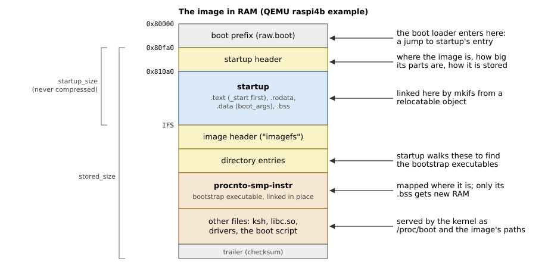

# The Image

Startup does not come alone: it is the first part of a QNX *boot image*,
one file that holds everything the system needs to start. This chapter
shows what the image looks like, how startup becomes part of it, and how
startup finds its way around it.

## Building an image

QNX's `mkifs` utility builds an image from a *build file*, a text file
that lists:

- the **bootstrap section**: first the startup program and its command
  line, then the *bootstrap executables* (normally just the kernel,
  `procnto-smp-instr`), each with its own command line and environment;
- the **boot script**, the commands the kernel runs once it is up;
- the **files**: programs, libraries and configuration, which the kernel
  serves from memory under `/proc/boot` and the other paths the build
  file gives.

A build file's bootstrap section looks like Listing 2.1, from a
Raspberry Pi 4 image.

*Listing 2.1: The bootstrap section of a build file.*

```text
[image=0x80000]
[+keeplinked]
[virtual=aarch64le,raw] .boot = {
    startup-bcm2711-rpi4 -v -D miniuart -u reg
    PATH=/proc/boot:/bin LD_LIBRARY_PATH=/proc/boot:/lib procnto-smp-instr -v
}
```

`[image=0x80000]` is the physical address the image is loaded at.
`virtual=aarch64le` says that the system uses the MMU; `raw` that the
image is a plain block of bytes, which the boot loader copies to RAM and
jumps into. `+keeplinked` makes mkifs link each bootstrap executable at
its final address in the kernel's address space, so that startup only has
to map it (Chapter 11).

## The image's layout

Figure 2.1 shows the image as mkifs lays it out and as the boot loader
leaves it in RAM.



*Figure 2.1: The boot image in RAM.*

- The **boot prefix** comes from the SDP (`boot/sys/raw.boot` for a raw
  AArch64 image): code that jumps to startup's entry point, since boot
  loaders enter an image at its first byte.
- The **startup header** describes the image: where it is, where it runs,
  how big startup and the image file system are, and whether the file
  system is compressed.
- **Startup** follows: its code and data, and room for its `.bss`.
- The **image file system** (IFS) starts with its own header and a
  directory of variable-size entries, followed by the files' data. The
  bootstrap executables are among the files, marked as such in their
  directory entries.

## The startup header

Listing 2.2 is the startup header as the library sees it, the Rust mirror
of `struct startup_header` in `<sys/startup.h>`.

*Listing 2.2: The startup header, `StartupHeader` (`src/abi/startup.rs`).*

```rust
{{#include ../../src/abi/startup.rs:startup_header}}
```

The fields startup needs are few:

- `image_paddr` and `startup_size` locate the image file system: it starts
  right after startup, at `image_paddr + startup_size`;
- `ram_paddr` and `ram_size` give the RAM the image itself occupies, which
  startup must keep out of the kernel's free memory;
- `flags1` says whether the image uses the MMU and whether the file system
  is compressed (this library supports uncompressed images only);
- `addr_off` is added to the 32-bit addresses for images above 4 GB.

Its fields are 32 bits wide because the format predates 64-bit systems.

## Startup as a relocatable object

The image is linked for one address, but the same startup program must
work in images at any address. QNX solves this by shipping startup not as
an executable but as a *relocatable object*: the output of a partial link
(`ld -r`), with its relocations still in it. mkifs does the final link
itself, at the address where the startup code lands in the image.

So the build of a Rust startup ends the same way. The board crate is built
as a static library; a partial link with `-u _start` pulls in the entry
point and everything it reaches, and a small linker script merges the
compiler's per-function sections into the usual ones, with `_start` first.

*Listing 2.3: The partial-link script (`startup.ld`).*

```text
{{#include ../../startup.ld}}
```

The script puts `_start` first in `.text`, and that is where the image's
entry point ends up.

> [!WARNING]
> mkifs links startup with its own linker, which handles the relocation
> types that compilers emit for AArch64's small code model (`ADR_PREL_PG_HI21`,
> `ADD_ABS_LO12_NC`, `CALL26`, `ABS64`, and the like). Do not build startup
> with a large or position-independent code model.

## The boot arguments

Startup's command line (`-v -D miniuart -u reg` above) is not passed in
registers: mkifs writes it into startup itself. It looks for an area of
startup's data that begins with the signature `ddpvbskr` and overwrites it
with a `struct bootargs_entry` followed by the strings. Listing 2.4 is the
area the library reserves, and Listing 2.5 what mkifs writes there.

*Listing 2.4: The boot-arguments area, `boot_args` (`src/bootargs.rs`).*

```rust
{{#include ../../src/bootargs.rs:boot_args}}
```

*Listing 2.5: The boot-arguments header, `BootArgsEntry` (`src/abi/startup.rs`).*

```rust
{{#include ../../src/abi/startup.rs:bootargs_entry}}
```

The entry also gives the address of the startup header, which is how
startup finds it. Chapter 4 shows how the library parses the entry.

> [!NOTE]
> The area is 4 KB. The C library shares it with the bottom of startup's
> stack; this library keeps the two apart, so a long command line cannot
> collide with a deep call chain.

## The bootstrap executables

Each bootstrap executable is an ELF file in the image file system. mkifs
marks its directory entry with the `IFS_INO_BOOTSTRAP_EXE` bit in the inode
number, links it at its address in the kernel's address space, and records
in each segment's `p_paddr` where the segment's bytes are in the image.
Right before its entry point, the executable has a small header that
leads startup to a structure through which startup chains it to the next
executable. Chapter 11 follows the whole process.
