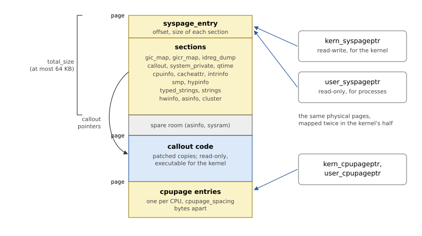
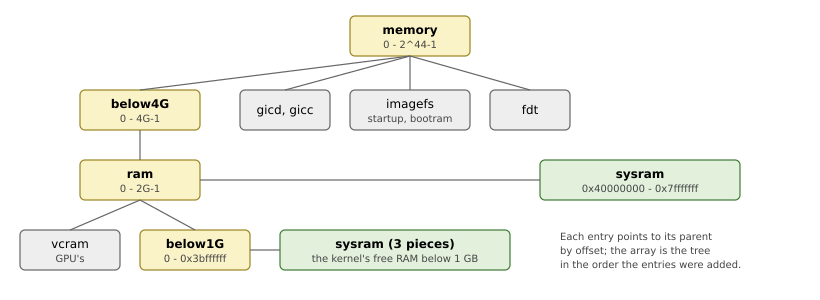

# The System Page

The system page is what startup leaves for the kernel: everything the
kernel knows about the board, in one block of memory. This chapter
describes its format, its sections, and how the library builds it.

## The format

The system page starts with a header, `struct syspage_entry`, and the
*sections* follow. The header does not contain the sections: it records
each section's offset from the start of the system page and its size, in
16-bit fields (Listing 6.1). The kernel, and the C library in every
process, find a section through its entry, with the `SYSPAGE_ENTRY()`
macro.

*Listing 6.1: The header, `SyspageEntry` (`src/abi/syspage.rs`).*

```rust
{{#include ../../src/abi/syspage.rs:syspage_entry}}
```

An `EntryInfo` is `syspage_entry_info` (offset and size), and an
`ArrayInfo` is `syspage_array_info`, which adds the size of one element,
for the sections that are arrays: `asinfo`, `cpuinfo`, `cacheattr`,
`intrinfo`, `cluster`. Because offsets are 16 bits, the whole system page,
`total_size`, is at most 64 KB.

The `un` union holds the architecture's part. On AArch64
(Listing 6.2) it gives the address of the page tables' level 0 (Chapter
10) and three more sections, indexed by CPU number: each CPU's interrupt
controller target (`gic_map`), its GICv3 redistributor (`gicr_map`), and a
copy of its ID registers (`idreg_dump`).

*Listing 6.2: The AArch64 part, `Aarch64SyspageEntry` (`src/abi/syspage.rs`).*

```rust
{{#include ../../src/abi/syspage.rs:aarch64_syspage_entry}}
```

## The memory it lives in

The sections are not the end of it. The memory holding the system page
(Figure 6.1) also holds the callouts' code (Chapter 7) and, for each CPU,
a *cpupage*: a small per-CPU structure the kernel uses for data that
user code may read, such as the CPU's number.



*Figure 6.1: The memory of the system page.*

The kernel and processes see the same physical pages twice: at
`kern_syspageptr`, writable for the kernel, and at `user_syspageptr`,
read-only for processes. The callouts' code is read-only and executable
for the kernel. The `system_private` section records these addresses, and
the cpupages' (Listing 6.3 shows a cpupage).

*Listing 6.3: A CPU's page, `CpupageEntry` (`src/abi/syspage.rs`).*

```rust
{{#include ../../src/abi/syspage.rs:cpupage_entry}}
```

## The sections

Table 6.1 lists the sections and the chapter that fills each in.

*Table 6.1: The sections of the system page.*

| Section | Contents | Chapter |
|---|---|---|
| `system_private` | Where the system page and cpupages are mapped, page size | 13 |
| `qtime` | The clock: counter frequency, tick interrupt | 9 |
| `callout` | Debug output, reboot | 7 |
| `cpuinfo` | Each CPU: ID, speed, features, caches | 9 |
| `cacheattr` | Each cache: geometry, maintenance callout | 9 |
| `intrinfo` | Each interrupt controller: vectors, callouts | 8 |
| `smp` | The IPI callout; how secondary CPUs enter the kernel | 12 |
| `hypinfo` | Hypervisor flags (none) | |
| `asinfo` | The physical address space, as a tree | 5, below |
| `hwinfo` | Devices, for drivers | below |
| `typed_strings` | `confstr()` values: machine name, host name | below |
| `strings` | Names, referred to by offset from other sections | below |
| `cluster` | CPU clusters (none) | |
| `gic_map`, `gicr_map`, `idreg_dump` | AArch64, per CPU | 8, 9 |

Most sections are fixed-size structures the library fills in field by
field. Four have structure of their own, described next: the address
space, the devices, and the two string sections.

## The address space: `asinfo`

`asinfo` describes the physical address space as a tree of named ranges
(Figure 6.2). The root, `memory`, is the whole range the CPU can address;
`ram` entries say where RAM is, `sysram` entries what of it is free for
the kernel, and other entries name what drivers and the kernel look for:
the image file system, a device's registers, memory a DMA engine can reach.



*Figure 6.2: The asinfo tree of a 2 GB Raspberry Pi 4.*

The tree is *flattened*: entries are in an array, and each points to its
parent by its offset in the section (`owner`, `0xffff` for a root). An
entry with children has the `AS_ATTR_KIDS` attribute; one range split
over several entries has `AS_ATTR_CONTINUED` on all but the last. Names
are offsets into the `strings` section.

Startup often knows a range but not the entry it belongs under. Free RAM
below 1 GB on the Raspberry Pi belongs under `below1G`, the rest directly
under `ram`, and a single free range can span both. `add_containing()`
(Listing 6.4) does what QNX's `as_add_containing()` does: it cuts the
range into pieces, one for each entry named `container` or descending
from one, and places each piece under the deepest such entry.

*Listing 6.4: Adding a range under its containers, `Asinfo::add_containing()` (`src/syspage/asinfo.rs`).*

```rust
{{#include ../../src/syspage/asinfo.rs:add_containing}}
```

Because entries come after their parents in the array, painting the
matching entries over the range in array order leaves each piece with
its deepest owner.

## The devices: `hwinfo`

`hwinfo` describes devices for the drivers that want defaults: a network
driver can find its controller's registers, interrupts and MAC address
there instead of on its command line. The kernel itself only needs the
root.

It is another flattened tree, of 32-bit words. Every entry starts with a
`hwi_prefix`: its size in words and its name (an offset into `strings`).
*Items* (a `Group`, a `Bus`, a `Device`; their names start with a capital
letter) also record their own size including their tags, a name of their
own, their owner's offset and their number of children. *Tags* (`location`,
`irq`, `inputclk`, `nicaddr`, ...) belong to the item before them. Listing
6.5 adds a tag; Listing 6.6 shows the common tags.

*Listing 6.5: Adding a tag, `Hwinfo::add_tag()` (`src/syspage/hwinfo.rs`).*

```rust
{{#include ../../src/syspage/hwinfo.rs:hwinfo_tag}}
```

A `location` has a 64-bit base address, which must be 8-byte aligned in
the section; when it would not be, a one-word `pad` tag goes first.

*Listing 6.6: The common tags (`src/syspage/hwinfo.rs`).*

```rust
{{#include ../../src/syspage/hwinfo.rs:hwinfo_tags}}
```

Every system has the root group `hw` and, under it, the bus `unknown` for
devices on no particular bus; `add_default()` adds both, and a board adds
its devices after them.

## The strings

`strings` is a pool of NUL-terminated names that other sections refer to
by offset: asinfo and hwinfo names, the CPUs' names. The pool stores each
name once (Listing 6.7).

*Listing 6.7: The strings pool, `StringPool` (`src/syspage/strings.rs`).*

```rust
{{#include ../../src/syspage/strings.rs:string_pool}}
```

`typed_strings` holds the values behind `confstr()`: each entry is a
32-bit `_CS_*` constant from `<confname.h>` followed by a string, padded to
4 bytes, and a 0 ends the list (Listing 6.8). Startup sets the machine name
(`_CS_MACHINE`, which `uname -m` prints), the hardware maker and serial
number, the SoC, and the host name (`localhost` unless `-N` gives one).

*Listing 6.8: The typed strings, `TypedStrings` (`src/syspage/strings.rs`).*

```rust
{{#include ../../src/syspage/strings.rs:typed_strings}}
```

## Building it

QNX's startup library grows the system page in place: each section is
allocated in a temporary buffer as it is created, and growing one moves
all the sections after it. The library takes a simpler way. While startup
runs, each section is a separate Rust value in `Syspage` (Listing 6.9),
and the sections are laid out only once, when the system page is written.

*Listing 6.9: The system page builder, `Syspage` (`src/syspage/mod.rs`).*

```rust
{{#include ../../src/syspage/mod.rs:syspage_struct}}
```

This works because no section refers to another by address: asinfo
owners are offsets within asinfo, names are offsets within strings. The
only addresses in the sections are the callouts' and the mappings', and
they are filled in last.

`layout()` (Listing 6.10) places the sections one after the other, each
8-byte aligned, and fills in the header. `write()` then copies the header
and every section to their offsets in the final memory. A system with one
CPU has no `smp` section.

*Listing 6.10: Placing the sections, `Syspage::layout()` (`src/syspage/mod.rs`).*

```rust
{{#include ../../src/syspage/mod.rs:layout}}
```

> [!NOTE]
> The order of the sections in memory differs from QNX's startup library,
> which puts them in the order they were first created. The kernel finds
> every section through the header, so the order does not matter; Chapter
> 15 compares the two system pages.
