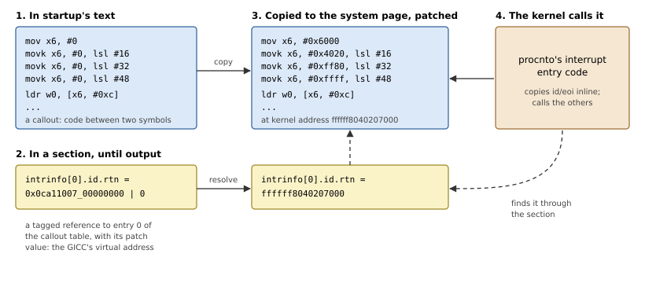

# Callouts

The system page describes the board, but description is not always
enough. To acknowledge an interrupt, the kernel must write a register of
the interrupt controller; to print a debug message, it must drive a UART.
These are small pieces of board code that the kernel runs long after
startup is gone. QNX calls them *callouts*. This chapter explains what a
callout may and may not do, and how the library packages, copies and
patches them.

## What the kernel calls

Table 7.1 lists the callouts of QNX OS 8.0 on AArch64, and the section
that holds each one's address.

*Table 7.1: The callouts.*

| Callout | Section | Called to |
|---|---|---|
| `display_char`, `poll_key`, `break_detect` | `callout.debug[]` | Print a character, read one, detect a break, on the debug channel |
| `reboot` | `callout.reboot` | Reset the board |
| `id`, `eoi` | `intrinfo[].id`, `.eoi` | Find which interrupt is pending; end it |
| `mask`, `unmask`, `config` | `intrinfo[]` | Disable or enable one interrupt; flag special ones |
| `control` | `cacheattr[].control` | Clean or invalidate a range of a cache |
| `send_ipi` | `smp.send_ipi` | Interrupt another CPU |
| `smp_spin` | (startup only) | Where secondary CPUs wait for the kernel (Chapter 12) |

Listing 7.1 is the `callout` section itself.

*Listing 7.1: The callout section, `CalloutEntry` (`src/abi/syspage.rs`).*

```rust
{{#include ../../src/abi/syspage.rs:callout_entry}}
```

## The rules for a callout

A callout runs in the kernel, with the MMU on, at whatever virtual
address its copy in the system page has. Three rules follow:

1. **Position independence.** The callout is copied, so it may not refer
   to anything by an absolute address it was linked with. Branches inside
   it are relative and fine.
2. **Nothing of startup.** Startup's code and data are not mapped for the
   kernel. A callout may use its arguments (the first is always the
   system page's address), the system page, and values patched into it.
3. **Device addresses are virtual.** A device's registers must be mapped
   for the kernel, and the callout must use that virtual address, which is
   only known once startup has made the mapping.

Most callouts follow the AArch64 procedure call standard: arguments in
`x0`-`x7`, a `ret` at the end, `x19`-`x28` preserved. The interrupt `id`
and `eoi` callouts are different: the kernel *copies their code into its
own interrupt entry path*, so they must not return, but fall through
their last instruction; they take and leave values in agreed registers
(Chapter 8).

> [!WARNING]
> A callout must not use the stack beyond what the procedure call
> standard allows, and must not take a long time: the kernel calls some
> callouts with interrupts disabled. The cache callouts, for instance, do
> at most 32 lines per call and return how many they did.

## Patching

Rule 3 means a callout's code cannot be final until startup runs. QNX's
answer, which the library keeps, is to start a callout with instructions
that load a placeholder, and patch them in the copy. A 64-bit value
takes four instructions on AArch64: `movz` loads 16 bits and clears the
rest, and three `movk` keep the rest and insert 16 more bits each:

```text
mov  x6, #0               // bits 0-15
movk x6, #0, lsl #16      // bits 16-31
movk x6, #0, lsl #32      // bits 32-47
movk x6, #0, lsl #48      // bits 48-63
```

Each instruction keeps its 16-bit immediate in bits 5-20. Patching
(Listing 7.2) replaces those bits with the value's four slices. It first
checks that the four words really are `movz`/`movk` with the expected
shifts, so that a callout whose patch site was moved fails at boot with a
message, instead of being corrupted.

*Listing 7.2: Patching a 64-bit constant, `patch_mov64()` (`src/callout.rs`).*

```rust
{{#include ../../src/callout.rs:patch_mov64}}
```

QNX's callouts carry a *patcher* function, written in assembly too, that
startup calls for each copy. In the library, the convention is fixed
instead: a callout declares how many patch values it takes, and starts
with that many four-instruction sequences, which the library patches in
order. A callout that needs other data (the address of a read/write area
in the system page, say) gets it the same way, as a patch value.

## Defining a callout

The `callout!` macro (Listing 7.3) turns assembly lines into a callout: it
puts them between two symbols in a section of their own, and defines a
`Callout` that knows where the code starts and ends and how many values
to patch.

*Listing 7.3: The `callout!` macro (`src/callout.rs`).*

```rust
{{#include ../../src/callout.rs:callout_macro}}
```

A board's debug callout, for example, takes one patch value, the UART's
virtual address:

```rust
callout!(pub static DISPLAY_CHAR, "my_display_char", patches = 1,
    "mov     x7, #0", "movk x7, #0, lsl #16",
    "movk    x7, #0, lsl #32", "movk x7, #0, lsl #48",
    "0: ldr  w2, [x7, #STATUS]",      // wait for room
    "tbz     w2, #TX_READY, 0b",
    "str     w1, [x7, #DATA]",        // w1: the character
    "ret",
);
```

## From startup's text to the system page

Figure 7.1 shows a callout's way into the kernel.



*Figure 7.1: A callout, from startup's text to the kernel.*

While startup builds the system page, the callouts' final addresses are
not known: the system page has no memory yet. So a section that needs a
callout stores a *reference* to it instead. `Syspage::callout(&CALLOUT,
&[values])` records the callout and its patch values in a table (the same
callout with the same values is recorded once) and returns a tagged value:
a tag in the top 32 bits that no kernel address can have, and the table
index below.

When `boot()` has allocated the system page, `output()` (Listing 7.4)
copies every callout into the system page's callout area, 8-byte aligned,
patches its copy, and returns each one's kernel address.

*Listing 7.4: Copying and patching the callouts, `Table::output()` (`src/callout.rs`).*

```rust
{{#include ../../src/callout.rs:callout_output}}
```

`resolve_callouts()` (Listing 7.5) then walks every field of the sections
that can hold a callout and replaces each reference by the address. For
the interrupt callouts that the kernel copies, it also records the code's
size, which the kernel needs.

*Listing 7.5: Replacing references by addresses, `Syspage::resolve_callouts()` (`src/syspage/mod.rs`).*

```rust
{{#include ../../src/syspage/mod.rs:resolve_callouts}}
```

Mapping the device registers is the board's or the library's job, before
the callout is recorded: `Startup::map_device()` maps a register block for
the kernel and returns the virtual address to patch in (Chapter 10).
