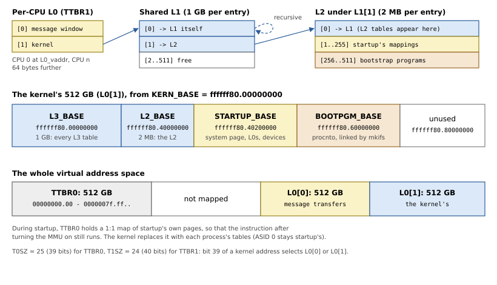

# The Kernel's Address Space

The kernel starts with the MMU on, at virtual addresses mkifs chose when
it linked it. Startup must build the page tables that make those
addresses work, in the exact shape the kernel expects, since the kernel
goes on using them. This chapter explains AArch64's translation tables,
QNX's layout of the kernel's address space, and the library's code.

## Translation on AArch64

With 4 KB pages, AArch64 translates a virtual address in up to four
steps. Each level of table has 512 entries of 8 bytes (one page), and
each level consumes 9 bits of the address:

| Bits | 47-39 | 38-30 | 29-21 | 20-12 | 11-0 |
|---|---|---|---|---|---|
| Used as | L0 index | L1 index | L2 index | L3 index | offset in the page |
| One entry covers | 512 GB | 1 GB | 2 MB | 4 KB | |

An entry at L0-L2 points to the next level's table (a *table
descriptor*), or at L1-L2 maps a whole 1 GB or 2 MB *block*. An L3 entry
maps a page (a *page descriptor*). Besides the address, a page or block
descriptor holds the mapping's attributes:

- `AP`, the access permissions: read-write or read-only, kernel only or
  also EL0;
- `UXN`, `PXN`: not executable at EL0, at EL1;
- `AttrIndx`: an index into the *Memory Attribute Indirection Register*,
  `MAIR_EL1`, which says what kind of memory it is (device or normal,
  cacheable or not);
- `SH`: shareability, which for normal memory says that the other CPUs'
  caches must be kept coherent with it;
- `AF`, the access flag: a mapping without it faults on first use.

The address space has two halves. Addresses with their top bits clear are
translated through the tables in `TTBR0_EL1`, those with their top bits
set through `TTBR1_EL1`. `TCR_EL1` sets how many bits each half has
(`T0SZ`, `T1SZ`: 64 less the number of bits), which also decides at which
level a walk starts.

## QNX's layout

QNX's kernel expects the layout of `<aarch64/mmu.h>`, shown in Figure
10.1:

- **TTBR0**: 39 bits (512 GB) for processes. During startup, it maps
  startup itself 1:1.
- **TTBR1**: 40 bits, two L0 entries of 512 GB each. Entry 0 is a
  per-CPU window the kernel maps another process's memory into while it
  copies a message; so each CPU has its own L0 table, 64 bytes apart.
  Entry 1 points to one L1 table that all CPUs share: the kernel's half.



*Figure 10.1: The kernel's address space, and the tables that make it.*

Inside the kernel's 512 GB, the kernel finds its own page tables through
*recursive* entries. L1[0] points back at L1: so a walk through L1[0]
reads L1 as if it were an L2 table, and the L2 tables as if they were L3
tables, and the 1 GB at `L3_BASE` shows every L3 table as data. L1[1]
points to the L2 table for the next gigabyte, and that L2's entry 0 points
back at L1, so that the L2 tables appear at `L2_BASE`. Startup's own
mappings (the system page, the L0 tables, the devices' registers) go from
`STARTUP_BASE`, and mkifs links the bootstrap executables from
`BOOTPGM_BASE`.

*Listing 10.1: The layout's addresses (`src/arch/aarch64/mmu.rs`).*

```rust
{{#include ../../src/arch/aarch64/mmu.rs:address_space}}
```

> [!WARNING]
> A table entry reached through a recursive entry is read as a *page*
> descriptor. So the library gives its table descriptors the attributes
> of a kernel read-write data page (valid, access flag, normal cacheable
> memory, not executable), as QNX's startup does. A bare table pointer
> would make the recursive views fault.

## The registers

The kernel keeps the memory attributes, translation control and system
control that startup sets, so their values are part of the contract. The
QNX startup specification gives them (Listing 10.2).

*Listing 10.2: `MAIR_EL1`, `SCTLR_EL1` and `TCR_EL1` (`src/arch/aarch64/mmu.rs`).*

```rust
{{#include ../../src/arch/aarch64/mmu.rs:registers}}
```

`MAIR_EL1` defines the eight memory types that `AttrIndx` selects. Its
order follows the ARMv7 encodings of memory types, so that AArch32
programs' requests to map memory a certain way (`shm_ctl_special()`) mean
the same on AArch64.

`TCR_EL1` takes two values from the CPU: the physical address size
(`ID_AA64MMFR0_EL1.PARange`, into `IPS`) and whether the CPU has 16-bit
ASIDs, which the kernel then uses. On QEMU's Cortex-A72, the result is
`0x14b5183519`, the value QNX's own startup prints for the same CPU.

## Mapping

Listing 10.3 makes an entry for a mapping from its protection. Device
memory is strongly ordered (device-nGnRnE) or merely ordered (nGnRE);
RAM is write-back cacheable, or non-cacheable on request; and with more
than one CPU, RAM is inner shareable, so that the CPUs' caches stay
coherent.

*Listing 10.3: Making a page entry, `Mmu::pte()` (`src/arch/aarch64/mmu.rs`).*

```rust
{{#include ../../src/arch/aarch64/mmu.rs:pte}}
```

`Mmu::new()` (Listing 10.4) allocates the tables of Figure 10.1: the TTBR0
L1, the shared L1 with its recursive entry, the L2 for startup's range with
its own, and the L0 tables, which it maps at the start of startup's range.
Their address there is `L0_vaddr`, which the system page records.

*Listing 10.4: The initial tables, `Mmu::new()` (`src/arch/aarch64/mmu.rs`).*

```rust
{{#include ../../src/arch/aarch64/mmu.rs:mmu_new}}
```

`Mmu::map()` (Listing 10.5) maps a range page by page, allocating L2 and
L3 tables as it needs them. Startup maps three kinds of thing:

- **device registers** for callouts, with `Startup::map_device()`, at the
  next free address of startup's range;
- **the system page**, twice in the same range (Chapter 13);
- **the bootstrap executables**, at the addresses mkifs linked them at
  (Chapter 11);

plus startup itself, 1:1 in TTBR0.

*Listing 10.5: Mapping a range, `Mmu::map()` (`src/arch/aarch64/mmu.rs`).*

```rust
{{#include ../../src/arch/aarch64/mmu.rs:mmu_map}}
```

All of this happens with the MMU off: the tables are written at their
physical addresses, and nothing uses them until each CPU turns its MMU on
in the handoff (Chapter 13).

> [!NOTE]
> QNX's startup library uses the *contiguous* hint for runs of 16 aligned
> pages, which lets the TLB cache them as one entry. The library maps
> single pages only. That makes no difference to the kernel's behavior,
> only to how many TLB entries the initial mappings take.
