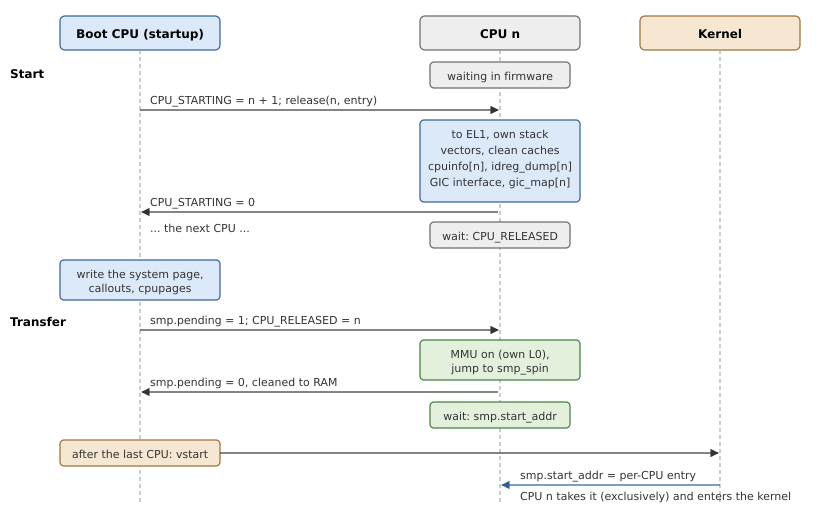

# Secondary CPUs

The kernel starts on one CPU and brings the others in itself, but it
expects to find them ready: at EL1, MMU on, with their own page tables,
waiting in the `smp_spin` callout. This chapter shows how startup gets
them there, in two steps that follow QNX's startup library.

## Where the other CPUs are at first

When the boot CPU enters startup, the other CPUs are already running
firmware: they wait in a loop until they are told where to go. How they
are told depends on the board:

- with a **spin table**, each CPU polls a word in memory, and starts at
  the address written there; the Raspberry Pi's firmware does this, with
  the table at 0xd8;
- with **PSCI**, the firmware's power interface, a CPU is started with a
  call to the secure monitor (`CPU_ON`);
- some SoCs have a register that sets a CPU's reset address.

The library leaves this to the board: `Startup::init_smp(n, release)`
takes the number of CPUs and a function `release(cpu, entry)` that makes
CPU `cpu` run from the physical address `entry` (Listing 12.1). It must
come before the page tables are built, since each CPU gets its own level
0 table.

*Listing 12.1: Configuring SMP, `Startup::init_smp()` (`src/startup.rs`).*

```rust
{{#include ../../src/startup.rs:init_smp}}
```

## Two steps

Figure 12.1 shows the protocol.



*Figure 12.1: Starting a secondary CPU, and its way into the kernel.*

**Start.** While the system page is still being built, the boot CPU
releases the CPUs one at a time and waits for each. A released CPU moves
to EL1 and describes itself: only it can read its own ID registers and
set up its own GIC interface. It then signals that it is done, and waits.
Because the CPUs go one at a time, each can write its parts of the system
page without locks.

**Transfer.** Once the system page is written, the boot CPU lets the CPUs
go, again one at a time. Each turns its MMU on, with its own level 0
table, and jumps to `smp_spin` in the system page; `smp_spin` tells the
boot CPU it is there, and waits for the kernel. Only when every CPU is in
`smp_spin` does the boot CPU itself jump into the kernel.

## The entry of a secondary CPU

A released CPU starts at `__oscraft_secondary_start` (Listing 12.2), with
the MMU off and no stack. Its logical number is in `CPU_STARTING`, which
the boot CPU set before releasing it; the CPU takes its stack from an array
by that number, and calls Rust.

*Listing 12.2: A secondary CPU's entry (`src/arch/aarch64/smp.rs`).*

```rust
{{#include ../../src/arch/aarch64/smp.rs:secondary_entry}}
```

*Listing 12.3: A secondary CPU's work, `__oscraft_secondary_main()` (`src/arch/aarch64/smp.rs`).*

```rust
{{#include ../../src/arch/aarch64/smp.rs:secondary_main}}
```

Listing 12.4 is the boot CPU's side of both steps. Startup gives up on a
CPU that does not answer, after a long time, rather than hang; `-P` can
then start fewer.

*Listing 12.4: The boot CPU's side, `start_cpus()` and `transfer_cpus()` (`src/arch/aarch64/smp.rs`).*

```rust
{{#include ../../src/arch/aarch64/smp.rs:start_cpus}}
```

## Caches across the handover

During the transfer, the boot CPU still runs with its MMU and caches off,
while the CPU it waits for runs with them on. They share memory, but not
the same view of it: the secondary CPU's write to `smp.pending` lands in
its data cache, where the boot CPU's uncached read cannot see it. So
`smp_spin` (Listing 12.5) cleans the line to memory (`dc cvac`) after
writing it.

The other direction is safe: the boot CPU wrote the system page with its
caches off, straight to memory, and the secondary CPU had cleaned its
caches when it started, so no stale line hides those writes.

## `smp_spin`

*Listing 12.5: Where a CPU waits for the kernel, the `smp_spin` callout (`src/arch/aarch64/smp.rs`).*

```rust
{{#include ../../src/arch/aarch64/smp.rs:smp_spin}}
```

The kernel brings a CPU in by writing the address of its per-CPU
initialization into `smp.start_addr`. All waiting CPUs see it; the
exclusive load/store pair lets exactly one take it and clear it, so the
kernel can start the CPUs one at a time with the same word. A value of -1
means the system is shutting down: each CPU puts it back, wakes the
others, and stops.

> [!WARNING]
> `smp_spin` reads the `smp` section's offset from the system page header
> at a fixed offset (36), and the fields in it at fixed offsets. A
> compile-time assertion in `src/arch/aarch64/smp.rs` checks them against
> the Rust types; keep it next to the code.
