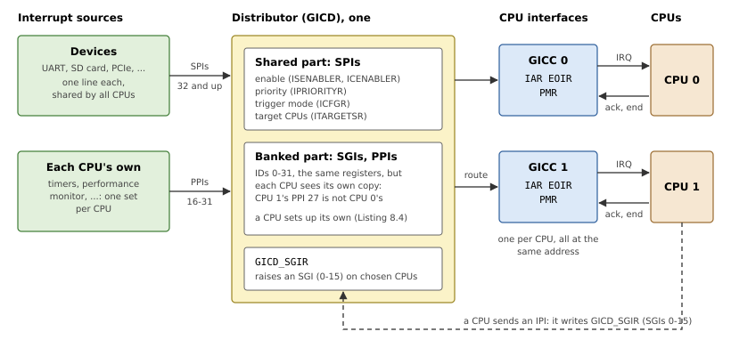
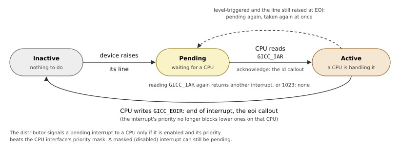
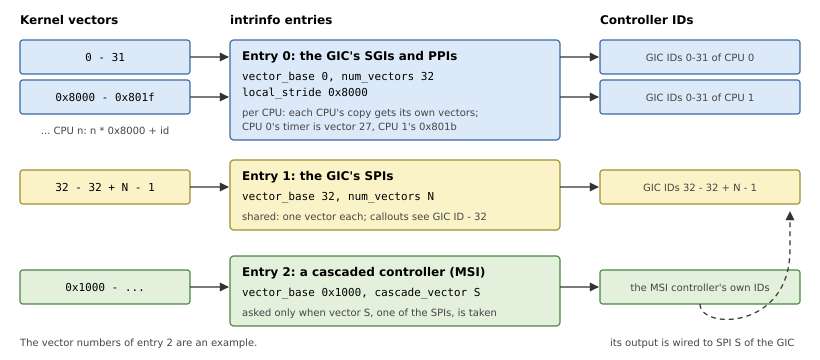
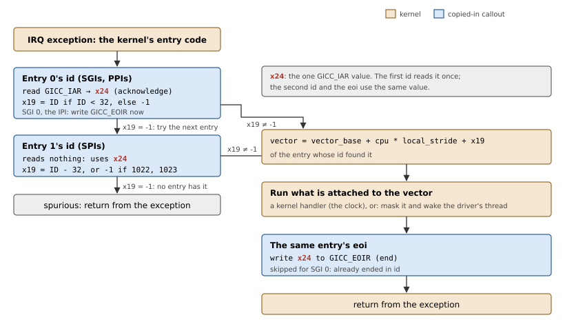
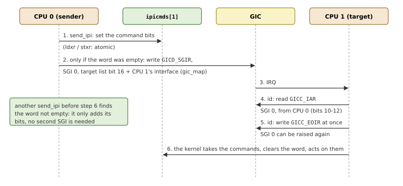

# Interrupts: the GICv2

A device that needs attention, a UART with a received byte or a timer
that expired, raises an *interrupt*: a signal that makes a CPU stop what
it is doing and run the kernel's interrupt code. This chapter first
explains what an interrupt controller does and how Arm's Generic
Interrupt Controller version 2 (GICv2) does it, then how QNX's kernel
handles interrupts without knowing which controller a board has, and
finally how the library describes a GICv2 to the kernel.

## What an interrupt controller is for

An AArch64 CPU has a single input for ordinary interrupts, *IRQ*. When it
is raised (and the CPU has not masked IRQs), the CPU takes an IRQ
exception: it jumps to the kernel's IRQ vector. That one input tells the
CPU *that* something needs attention, not *what*. A board, though, has
dozens or hundreds of interrupt sources, and several CPUs.

The *interrupt controller* sits between them. It:

- **collects** every source's interrupt line, and remembers which ones
  are raised (*pending*);
- **filters**: each source can be enabled or disabled (*masked*)
  individually;
- **prioritizes**: when several are pending, it signals the most
  important one first;
- **routes** each source to one CPU, or several, and raises those CPUs'
  IRQ input;
- **identifies**: the CPU asks it which interrupt it is taking
  (*acknowledge*), and tells it when it is done (*end of interrupt*, EOI).

So an interrupt has a life cycle in the controller, which Figure 8.2
below shows for the GIC: raised by the device, pending, acknowledged and
active while the CPU handles it, and ended.

The kernel only needs a handful of operations from a controller:
identify the pending interrupt, end it, mask and unmask a source. Those
are exactly the interrupt callouts of Chapter 7; the rest of what a
controller can do (priorities, routing, trigger modes) startup sets up
once, here.

> [!NOTE]
> An interrupt line is either *level-triggered*, raised for as long as
> the device needs attention, or *edge-triggered*, a pulse per event.
> QNX uses level-triggered interrupts only: the device keeps its line
> raised until a driver has serviced it. This is why the kernel masks an
> interrupt that it hands to a driver's thread, until the driver calls
> `InterruptUnmask()`: ended but still raised, it would be taken again
> at once.

## How a GICv2 works

A GICv2 (the GIC-400 is one) has two parts, as Figure 8.1 shows:

- the **distributor** (GICD), one for the system: it knows every
  interrupt, enables or disables it, gives it a priority and, for shared
  interrupts, chooses which CPUs receive it;
- one **CPU interface** (GICC) per CPU, at the same address on every CPU
  (each CPU sees its own): the CPU reads the *Interrupt Acknowledge
  Register* (`GICC_IAR`) to learn which interrupt it is taking, and writes
  the same value to the *End Of Interrupt Register* (`GICC_EOIR`) when it
  is done.



*Figure 8.1: A GICv2: three classes of interrupts, one distributor, one CPU interface per CPU.*

Interrupts have IDs, in three classes:

- **SGIs**, 0 to 15: software-generated, raised by writing the
  distributor's `GICD_SGIR` with a list of target CPUs. Operating systems
  use them as *inter-processor interrupts* (IPIs);
- **PPIs**, 16 to 31: private to each CPU, such as the CPU's own timer
  (the virtual timer is PPI 27);
- **SPIs**, 32 and up: shared, the devices' interrupts.

SGIs and PPIs exist once *per CPU*: every CPU has its own PPI 27, its own
timer behind it, and its own SGI 0. The distributor's registers for IDs
0-31 are therefore *banked*: at the same address, each CPU sees and
changes its own copy. SPIs exist once, and the distributor's
`GICD_ITARGETSR` registers say which CPU interfaces each one goes to.

Each interrupt has a priority, from 0 (highest) to 255 (lowest). A CPU
interface signals the highest-priority pending interrupt, and only if its
priority is higher (numerically lower) than the interface's *priority
mask* (`GICC_PMR`).

Figure 8.2 shows an interrupt's life cycle. Reading `GICC_IAR` is not a
plain read: it *acknowledges* the interrupt it returns, moving it from
pending to active, so that the interface signals the next one. A second
read returns a different interrupt, or 1023, "nothing pending" (a
*spurious* interrupt: one that went away, or that another CPU took).
Writing `GICC_EOIR` ends the interrupt; a level-triggered one whose line
is still raised becomes pending again.



*Figure 8.2: An interrupt's life cycle in the GIC, and what moves it on.*

## How the kernel sees interrupts

The kernel knows no interrupt controller. It numbers interrupts with
*vectors*, the numbers a driver passes to `InterruptAttachThread()`, and
the `intrinfo` section maps vector ranges to controllers (Listing 8.1).
An entry covers `num_vectors` vectors from `vector_base`, and its
callouts take and return interrupts *relative* to `vector_base`, as the
controller numbers them.

*Listing 8.1: An interrupt controller range, `IntrinfoEntry` (`src/abi/syspage.rs`).*

```rust
{{#include ../../../src/abi/syspage.rs:intrinfo_entry}}
```

Two fields need more than a range:

- **`local_stride`**: an entry whose interrupts exist once per CPU, as
  the GIC's SGIs and PPIs do, sets it to a nonzero stride. The kernel
  then gives each CPU's copy a vector of its own: `vector_base + cpu *
  local_stride + id`. With a stride of 0x8000, CPU 0's timer is vector
  27, CPU 1's is 0x801b, so a driver can attach to one CPU's interrupt.
- **`cascade_vector`**: a controller can be wired into an input of
  another one (*cascaded*); its entry then names the vector of that
  input, and the kernel asks the second controller only when that vector
  is the one taken.

Figure 8.3 shows the vectors of a GICv2 board with such a second
controller.



*Figure 8.3: Vectors: two entries for the GIC, the first per CPU, and a cascaded controller.*

### From IRQ to end of interrupt

When a CPU takes an IRQ exception, the kernel tries the entries in
order, as Figure 8.4 shows:

1. it runs the entry's `id` callout, which returns the pending interrupt
   relative to the entry, or -1 if the entry has none;
2. on -1 it goes on with the next entry; otherwise the vector is
   `vector_base + cpu * local_stride + id`;
3. it runs whatever is attached to the vector, or masks it if nothing is
   (for a driver's thread, it masks the vector and wakes the thread);
4. it runs the same entry's `eoi` callout, which ends the interrupt in
   the controller.



*Figure 8.4: The kernel's way from an IRQ to its end, with the GIC's two entries.*

This runs for every interrupt, so speed matters: `id` and `eoi` are not
called but *copied* into the kernel's interrupt entry code (Chapter 7),
and work with fixed registers instead of arguments. Their `genflags` ask
the kernel to load values for them first:

- `x19` returns the interrupt, relative to the entry's `vector_base`, or
  -1 if the entry has none pending; `eoi` gets it back in `x19`;
- `x20` holds the system page's address, `x21` the entry's, `x22` the
  interrupt's mask count, `x24` the CPU number, when `genflags` ask for
  them;
- the code must leave the kernel's other registers alone, and fall
  through its end.

The other interrupt callouts are ordinary functions. `mask` and `unmask`
take the system page and the vector (relative to the entry), and return
0. `config` returns flags for a vector, such as `INTR_CONFIG_FLAG_IPI` for
the one the kernel uses for IPIs.

## The GIC as two ranges

A GICv2 becomes two `intrinfo` entries (Figure 8.3):

- vectors 0-31, the SGIs and PPIs, with `local_stride` 0x8000, since they
  are per CPU;
- vectors 32 and up, the SPIs, as many as the distributor's `GICD_TYPER`
  says the GIC has.

Listing 8.2 sets the GIC up and describes it.

*Listing 8.2: Setting up the GIC, `gic_v2::init()` (`src/arch/aarch64/gic_v2.rs`).*

```rust
{{#include ../../../src/arch/aarch64/gic_v2.rs:gic_init}}
```

The distributor is turned off while startup sets every SPI to disabled,
not pending, priority 0xa0, level-triggered, and routed to the boot CPU's
interface; the kernel enables and reroutes interrupts as drivers attach
to them. The registers get `asinfo` entries (`gicd`, `gicc`) and kernel
mappings for the callouts. The same function records the `send_ipi`
callout in the `smp` section.

## The callouts

Two entries but one `GICC_IAR` is the GIC's difficulty: the kernel runs
the SGI/PPI entry's `id` first, and if that reads `GICC_IAR` and finds an
SPI, the SPI is already acknowledged. The SPI entry's `id` cannot read
the register again; it would get the next interrupt, or 1023.

So the two `id` callouts work as a pair (Figure 8.4). The first, in the
SGI/PPI entry, reads `GICC_IAR` once and keeps the value in `x24`, which
the entries' `genflags` leave to the callouts; it returns the ID if it is
below 32, and -1 otherwise. The second, in the SPI entry, reads nothing:
it takes the same `x24` and returns the ID less 32, or -1 for the
spurious IDs 1022 and 1023. Both entries' `eoi` write `x24` back to
`GICC_EOIR`. Listing 8.3 shows the callouts.

*Listing 8.3: The GICv2 callouts (`src/arch/aarch64/gic_v2.rs`).*

```rust
{{#include ../../../src/arch/aarch64/gic_v2.rs:gic_callouts}}
```

### Inter-processor interrupts

On a multi-core system, a CPU sometimes needs another one to act now:
to reschedule because a thread became ready there, to flush a TLB entry
after a mapping changed, to stop. It does so with an *inter-processor
interrupt*. QNX keeps one word of pending commands per CPU,
`ipicmds[cpu]`, and one interrupt to say "look at your word": on a GIC,
SGI 0.

`send_ipi(syspage, target, cmd, &ipicmds[cpu])` sets the command bits in
the target CPU's word with an exclusive load/store pair, and raises SGI 0
on it only if the word was empty: a CPU with an IPI already pending will
see the new command too. The kernel takes `target` from `gic_map`, so it
is the CPU's GIC interface number, not its number in the kernel, and the
callout sets bit `16 + target` of `GICD_SGIR`, the target list. This is
why each CPU records its interface in `gic_map` when it starts.



*Figure 8.5: CPU 0 sends an IPI to CPU 1.*

On the receiving side, SGI 0's `GICC_IAR` value carries the sending
CPU's number in bits 10-12, and the PPI `id` callout ends it immediately
with that full value, so that the IPI can be raised again while the
kernel handles the commands; `eoi` then skips it.

## Each CPU's interface

The distributor's SPI registers are set up once, by the boot CPU. The
banked registers, for SGIs and PPIs, and each CPU interface can only be
set up by the CPU they belong to, so each CPU sets up its own when it
starts (Listing 8.4). It finds its interface number in
`GICD_ITARGETSR0`, which reads as the reading CPU's own interface, and
records it in `gic_map`. Then it gives its SGIs and PPIs priorities (0xc0
for the IPI, 0xa0 for the rest), enables the SGIs and disables the PPIs
(the kernel enables the timer's), sets the priority mask to 0xf0, which
lets every one of those priorities through, and enables the interface.

*Listing 8.4: Setting up a CPU's interface, `gic_v2::init_cpu()` (`src/arch/aarch64/gic_v2.rs`).*

```rust
{{#include ../../../src/arch/aarch64/gic_v2.rs:gic_cpu_init}}
```

## Other controllers

A board may have more controllers: the BCM2711, for example, has an MSI
controller for PCI Express, cascaded into one of the GIC's SPIs. A board
adds such a controller as one more `intrinfo` entry with its own callouts,
and `cascade_vector` set to the SPI it signals through. The library
provides the GICv2 only; GICv3, with its per-CPU redistributors and
system-register CPU interface, would need its own module.

A board may also have no GIC at all: the Raspberry Pi 3's BCM2837 has a
controller of its own for each core's timers and mailboxes, and the
older BCM2835 controller for the devices. Its board crate describes them
with `intrinfo` entries and callouts of its own, and IPIs with its own
`send_ipi`, as `init()` does here. The kernel needs nothing more: without
an interrupt controller module (`[module=gicv2]` in the build file), it
runs the callouts, and it finds the IPI's vector through the `config`
callout.

What the library cannot know is each CPU's part of the setup, which
`init_boot_cpu()` and every secondary CPU run. The controller registers
it with `Startup::set_cpu_intr_init()` (Listing 8.5); `init()` registers
`init_cpu()` above, and a board without a GIC registers its own.

*Listing 8.5: Each CPU's part of the setup, `Startup::set_cpu_intr_init()` (`src/startup.rs`).*

```rust
{{#include ../../../src/startup.rs:set_cpu_intr_init}}
```
