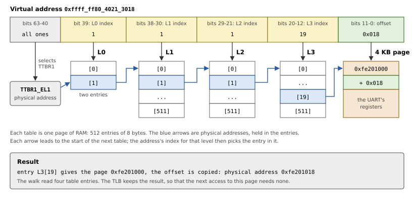
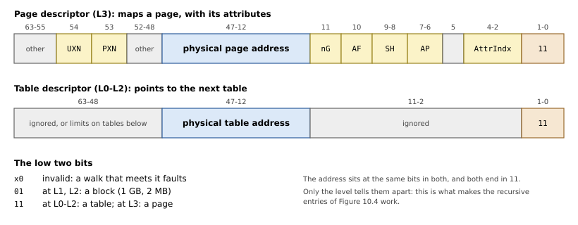
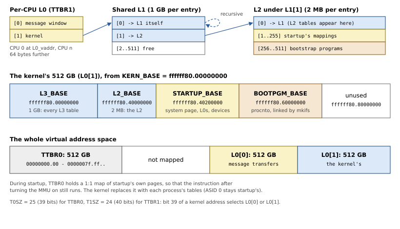
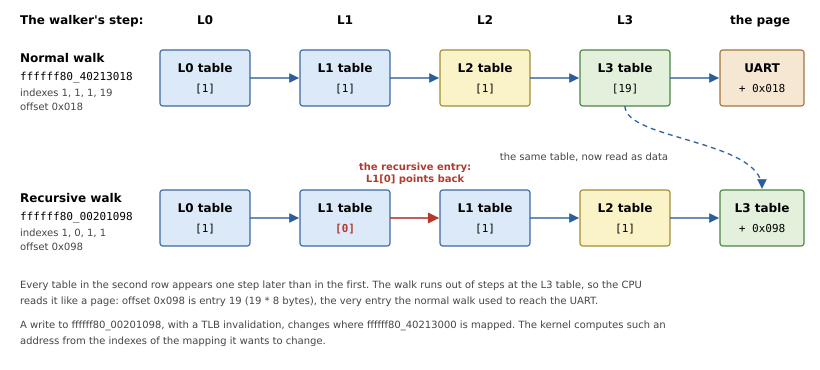

# The Kernel's Address Space

The kernel starts with the MMU on, at virtual addresses mkifs chose when
it linked it. Startup must build the page tables that make those
addresses work, in the exact shape the kernel expects, since the kernel
goes on using them. This chapter first explains what address translation
is and how AArch64 does it, following one address through the tables.
It then covers QNX's layout of the kernel's address space, and the
library's code.

## Why addresses are translated

With the MMU off, an address means what it says: the CPU puts it on the
bus, and whatever sits at that *physical address* answers. Startup runs
this way. With the MMU on, every address a program uses, for fetching
instructions as well as for loads and stores, is a *virtual address*: the
MMU translates it to a physical address first. That gives an operating
system three things:

- **Isolation**: each process has its own translation, so memory that
  is not in a process's map has no address the process could use.
- **Protection**: each mapping says what is allowed, so that code can be
  read-only and data not executable, and kernel memory can be out of
  reach of EL0.
- **Freedom of placement**: a program sees contiguous memory that may be
  scattered in RAM, and it can be linked for addresses that do not depend
  on where the board's RAM is. This is how mkifs can link the kernel at
  one fixed virtual address for every board.

Translating byte by byte would be impractical, so memory is divided into
*pages*, here of 4 KB. The low 12 bits of an address, the *offset*, pass
through unchanged; only the page number above them is translated.

The translation itself is data in memory that the CPU reads, the
*translation tables* or page tables. One flat array with an entry per
page would be simple, but with 48-bit addresses it would have 2<sup>36</sup>
entries of 8 bytes: 512 GB of table per address space, nearly all of it
describing nothing. So the tables are a tree instead: an unmapped region
of any size costs one empty entry high in the tree, and tables exist only
along the paths to pages that are mapped.

## Translation on AArch64

With 4 KB pages, AArch64 translates a virtual address in up to four
steps. Each level of table is itself one page of 512 entries of 8 bytes,
and 512 entries are selected by 9 bits, so each level consumes 9 bits of
the address:

| Bits | 47-39 | 38-30 | 29-21 | 20-12 | 11-0 |
|---|---|---|---|---|---|
| Used as | L0 index | L1 index | L2 index | L3 index | offset in the page |
| One entry covers | 512 GB | 1 GB | 2 MB | 4 KB | |

The hardware that follows this tree is the *table walker*. It starts from
the physical address of the top table, which a register holds, and takes
the index for that level from the virtual address. The entry there gives
the physical address of the next table, and so on, until the last entry
gives the physical page. An invalid entry anywhere ends the walk with a
*translation fault*, an exception.

Figure 10.1 follows one address, taken from Chapter 7: the debug callout
reading a PL011 UART's flag register, at offset 0x18 of the registers.
Say startup mapped those registers, at physical address `0xfe201000`, at
virtual address `0xffff_ff80_4021_3000`. The walk reads four table
entries and arrives at `0xfe201018`.



*Figure 10.1: A translation: each level's index comes from the address, each entry leads to the next table.*

Notice that the tables hold physical addresses: the walker cannot use
virtual ones, as it would need a translation to do its translating. The
mapping's size follows from where the walk ends, and it need not reach
L3: an entry at L1 or L2 can map a whole 1 GB or 2 MB *block*, with the
remaining bits of the address as the offset.

### What an entry holds

So an entry at L0-L2 points to the next level's table (a *table
descriptor*), or at L1-L2 maps a block. An L3 entry maps a page (a *page
descriptor*). Figure 10.2 shows the two kinds that startup writes: the
low two bits say what the entry is.



*Figure 10.2: A table descriptor and a page descriptor.*

Besides the address, a page or block descriptor holds the mapping's
attributes:

- `AP`, the access permissions: read-write or read-only, kernel only or
  also EL0;
- `UXN`, `PXN`: not executable at EL0, at EL1;
- `AttrIndx`: an index into the *Memory Attribute Indirection Register*,
  `MAIR_EL1`, which says what kind of memory it is (device or normal,
  cacheable or not);
- `SH`: shareability, which for normal memory says that the other CPUs'
  caches must be kept coherent with it;
- `AF`, the access flag: a mapping without it faults on first use.

The kind of memory matters as much as the address. RAM is *normal*
memory: the CPU may cache it, reorder accesses and read ahead. Device
registers must not be treated so. Reading a UART's data register takes a
byte out of its FIFO, so a cached or speculative read would lose data.
They are mapped as *device* memory, which is accessed exactly as the
program says.

### The TLB

A walk costs up to four memory reads, for every page a program touches,
so the CPU keeps recent translations in a cache, the *Translation
Lookaside Buffer* (TLB). This has two consequences. Writing a table entry
does not change a translation the TLB already holds: software must
invalidate it, as the handoff does before turning the MMU on (Chapter 13).
And to spare a flush of the TLB at every process switch, its entries are
tagged with an *Address Space Identifier* (ASID), so that the entries of
several processes can stay in it side by side. A mapping can instead be
*global*, valid in every address space, which is what the kernel's own
mappings are.

### Two halves

The address space has two halves. Addresses with their top bits clear are
translated through the tables in `TTBR0_EL1`, those with their top bits
set through `TTBR1_EL1`. `TCR_EL1` sets how many bits each half has
(`T0SZ`, `T1SZ`: 64 less the number of bits), which also decides at which
level a walk starts: 39 bits are exactly what L1 to L3 and the offset
consume, so a walk starts at L1, while a 40th bit needs an L0 table, of
two entries. An address whose top bits are neither all clear nor all set
is in neither half, and faults.

The split is what lets the kernel stay in place: switching processes
changes `TTBR0_EL1` alone, so the kernel's half is the same in every
address space, and an exception from a process needs no switch of tables
to reach kernel code.

## QNX's layout

QNX's kernel expects the layout of `<aarch64/mmu.h>`, shown in Figure
10.3:

- **TTBR0**: 39 bits (512 GB) for processes. During startup, it maps
  startup itself 1:1: virtual address equal to physical. Startup runs at
  physical addresses, and the instruction after the one that turns the
  MMU on is fetched through the tables, so its address has to mean the
  same with the MMU on (Chapter 13).
- **TTBR1**: 40 bits, two L0 entries of 512 GB each. Entry 0 is a
  per-CPU window the kernel maps another process's memory into while it
  copies a message; so each CPU has its own L0 table, 64 bytes apart.
  Entry 1 points to one L1 table that all CPUs share: the kernel's half.



*Figure 10.3: The kernel's address space, and the tables that make it.*

Startup's own mappings (the system page, the L0 tables, the devices'
registers) go from `STARTUP_BASE`, and mkifs links the bootstrap
executables from `BOOTPGM_BASE`.

*Listing 10.1: The layout's addresses (`src/arch/aarch64/mmu.rs`).*

```rust
{{#include ../../../src/arch/aarch64/mmu.rs:address_space}}
```

### Finding the tables: recursive entries

Once the MMU is on, the kernel has a problem: to change a mapping it must
write a table entry, and like any other code it can only reach memory
through virtual addresses, while the tables refer to each other by
physical ones. Each table would need a mapping of its own, and that
mapping would need tables too.

The kernel's way out is a *recursive* entry: an entry of a table that
points back at the table itself. The walker does not know which level a
table is meant to be. It counts steps, and takes whatever the entry
points to as the next level. So a walk through a recursive entry uses up
one step and stays where it is, and everything after it happens one level
higher than usual: it ends a level early, and the last table it reaches
is treated as the page. A table has become data at a virtual address.

Figure 10.4 compares the walk of Figure 10.1 with the walk that reaches
the L3 table it used. L1[0] is the recursive entry, so an address that
starts with L0 index 1 and L1 index 0 goes through L1 twice. Its next two
indexes then select L1[1] and L2[1], the path to that L3 table, and the
offset is the position in it: entry 19 is 19 * 8 = 0x98 bytes in.



*Figure 10.4: The same tables, one step later: the recursive walk arrives at the L3 table instead of the page.*

So the 1 GB at `L3_BASE`, the start of the kernel's half, shows every L3
table as data, in order. L2 tables take a second recursive step: L1[1]
points to the L2 table for the next gigabyte, and that L2's entry 0 points
back at L1, so that the L2 tables appear at `L2_BASE`.

> [!WARNING]
> A table entry reached through a recursive entry is read as a *page*
> descriptor: the two kinds have the same low bits (Figure 10.2). So the
> library gives its table descriptors the attributes of a kernel
> read-write data page (valid, access flag, normal cacheable memory, not
> executable), as QNX's startup does. In a normal walk, the walker ignores
> those bits. A bare table pointer would make the recursive views fault.

## The registers

The kernel keeps the memory attributes, translation control and system
control that startup sets, so their values are part of the contract. The
QNX startup specification gives them (Listing 10.2).

*Listing 10.2: `MAIR_EL1`, `SCTLR_EL1` and `TCR_EL1` (`src/arch/aarch64/mmu.rs`).*

```rust
{{#include ../../../src/arch/aarch64/mmu.rs:registers}}
```

`MAIR_EL1` defines the eight memory types that `AttrIndx` selects. Its
order follows the ARMv7 encodings of memory types, so that AArch32
programs' requests to map memory a certain way (`shm_ctl_special()`) mean
the same on AArch64.

`TCR_EL1` takes two values from the CPU: the physical address size
(`ID_AA64MMFR0_EL1.PARange`, into `IPS`) and whether the CPU has 16-bit
ASIDs, which the kernel then uses. On QEMU's Cortex-A72, the result is
`0x14b5183519`, the value QNX's own startup prints for the same CPU.

## Mapping

Listing 10.3 makes an entry for a mapping from its protection. Device
memory is strongly ordered (device-nGnRnE) or merely ordered (nGnRE);
RAM is write-back cacheable, or non-cacheable on request; and with more
than one CPU, RAM is inner shareable, so that the CPUs' caches stay
coherent.

*Listing 10.3: Making a page entry, `Mmu::pte()` (`src/arch/aarch64/mmu.rs`).*

```rust
{{#include ../../../src/arch/aarch64/mmu.rs:pte}}
```

`Mmu::new()` (Listing 10.4) allocates the tables of Figure 10.3: the TTBR0
L1, the shared L1 with its recursive entry, the L2 for startup's range with
its own, and the L0 tables, which it maps at the start of startup's range.
Their address there is `L0_vaddr`, which the system page records.

*Listing 10.4: The initial tables, `Mmu::new()` (`src/arch/aarch64/mmu.rs`).*

```rust
{{#include ../../../src/arch/aarch64/mmu.rs:mmu_new}}
```

`Mmu::map()` (Listing 10.5) maps a range page by page, allocating L2 and
L3 tables as it needs them. Its loop is the walk of Figure 10.1 in
software: `(va >> 30) & 0x1ff` is the L1 index, the next two shifts the L2
and L3 indexes, and `table()` follows an entry to the next table, or
allocates it if the entry is empty. It starts at L1 because that is where
a TTBR0 walk starts, and in TTBR1 `Mmu::new()` has already set the one L0
entry there is to set. Startup maps three kinds of thing:

- **device registers** for callouts, with `Startup::map_device()`, at the
  next free address of startup's range;
- **the system page**, twice in the same range (Chapter 13);
- **the bootstrap executables**, at the addresses mkifs linked them at
  (Chapter 11);

plus startup itself, 1:1 in TTBR0.

*Listing 10.5: Mapping a range, `Mmu::map()` (`src/arch/aarch64/mmu.rs`).*

```rust
{{#include ../../../src/arch/aarch64/mmu.rs:mmu_map}}
```

All of this happens with the MMU off: the tables are written at their
physical addresses, and nothing uses them until each CPU turns its MMU on
in the handoff (Chapter 13).

With `-E meltdown`, every mapping is *non-global* (the `nG` bit): it
belongs to one address space, ASID 0, rather than to all of them. The
kernel then switches its own mappings out while user code runs, which
closes the Meltdown side channel on CPUs that have it, at some cost in
speed. It is off by default, as in QNX's startup, and the Cortex-A72 does
not need it.

> [!NOTE]
> QNX's startup library uses the *contiguous* hint for runs of 16 aligned
> pages, which lets the TLB cache them as one entry. The library maps
> single pages only, and no blocks. That makes no difference to the
> kernel's behavior, only to how many TLB entries the initial mappings
> take.
