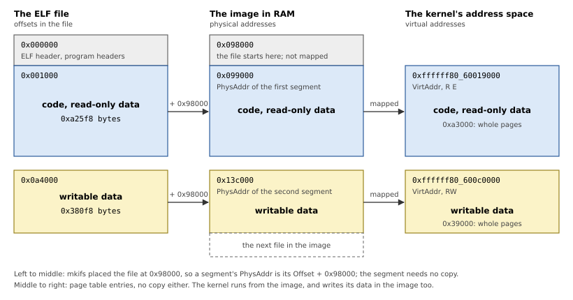
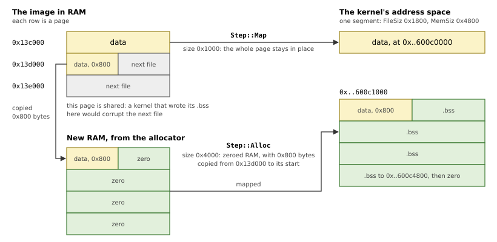
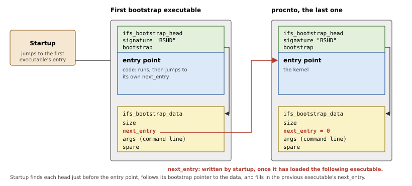

# Loading the Kernel

The kernel is a file in the image, and startup does not copy it anywhere:
mkifs has prepared it so that startup only has to map it. This chapter
explains how, starting with the ELF format the file is in.

## ELF segments

An ELF executable describes what to load with *program headers*
(`Elf64_Phdr`). Each `PT_LOAD` header is a *segment*: `p_filesz` bytes at
`p_offset` in the file, to appear at the virtual address `p_vaddr`, with
`p_memsz` bytes in all; the bytes beyond `p_filesz` (the `.bss`) are
zero. `p_flags` says whether the segment is readable, writable,
executable. A typical kernel has two segments: code and read-only data,
and writable data.

ELF also has a `p_paddr` field, a physical address, which most systems
ignore. QNX uses it.

## Linked in place

With `[+keeplinked]` in the build file, mkifs links each bootstrap
executable at its address in the kernel's half (from `BOOTPGM_BASE`, see
Chapter 10), places it in the image so that its segments start on page
boundaries, and records in `p_paddr` where each segment's bytes are in
the image. For the kernel of a Raspberry Pi 4 image, the program headers
read:

```text
  Type   Offset    VirtAddr           PhysAddr  FileSiz  MemSiz   Flg
  LOAD   0x001000  0xffffff8060019000 0x099000  0x0a25f8 0x0a25f8 R E
  LOAD   0x0a4000  0xffffff80600c0000 0x13c000  0x0380f8 0x0380f8 RW
```

The code is at 0x99000 in RAM, the data at 0x13c000; startup maps those
pages at the virtual addresses, and the kernel runs from the image, data
included. Figure 11.1 shows the same headers as a picture: `Offset` says
where a segment is in the file, `PhysAddr` where it is in RAM, and
`VirtAddr` where the kernel will see it. The file starts at 0x98000 in
RAM, so each `PhysAddr` is its `Offset` plus 0x98000.



*Figure 11.1: The kernel's two segments, with the Raspberry Pi 4 addresses above. Heights are not to scale.*

The program headers themselves are not part of any segment here: startup
reads them, but the kernel never sees them. Mappings cover whole pages,
which is why the code's 0xa25f8 bytes become 0xa3000 of address space.

Only a segment with a `.bss` needs new RAM. Its pages cannot all stay in
the image, for two reasons: the image holds no bytes for the `.bss`, and
the page where the file bytes end also holds the start of the next file
in the image, which the `.bss` must not overwrite. So that page is copied
to new RAM, and the rest of the new RAM is zero. Figure 11.2 shows a
segment of 0x1800 file bytes and 0x4800 bytes in memory, the case that
the library's unit test uses.



*Figure 11.2: A segment with a `.bss` takes two steps: whole pages stay in the image, the rest goes to new RAM.*

The library first works out these steps from a program header (Listing
11.1), with no side effects, which makes the logic testable on the host.

*Listing 11.1: The steps of loading a segment, `Step` (`src/elf.rs`).*

```rust
{{#include ../../../src/elf.rs:load_step}}
```

*Listing 11.2: Planning a segment, `elf::plan()` (`src/elf.rs`).*

```rust
{{#include ../../../src/elf.rs:plan}}
```

A segment with no `.bss` maps its last page whole, partial or not; mkifs
pads the image so that this page is the executable's own. A segment with
no `p_paddr` (an executable that was not kept linked) is copied whole to
new RAM.

`load_one()` (Listing 11.3) checks the ELF header and carries the steps
out, with the page tables and RAM of Chapters 5 and 10.

*Listing 11.3: Loading one executable, `load_one()` (`src/ifs.rs`).*

```rust
{{#include ../../../src/ifs.rs:load_one}}
```

## Chaining the bootstrap executables

An image may have more than one bootstrap executable: programs that run
between startup and the kernel. Startup starts the first; each passes
control to the next; the kernel is last. To make this possible, each
executable carries two small structures (Listing 11.4):

- an `ifs_bootstrap_head`, right before its entry point, with a signature
  ("BSHD") and the address of
- an `ifs_bootstrap_data`, where startup writes the next executable's
  entry point (`next_entry`), and which points to the executable's own
  command line.

Figure 11.3 shows how these link two executables.



*Figure 11.3: Chaining: the head leads to the data, and `next_entry` to the next executable.*

*Listing 11.4: The bootstrap structures (`src/abi/image.rs`).*

```rust
{{#include ../../../src/abi/image.rs:bootstrap_structs}}
```

The addresses are virtual, so startup translates them through the page
tables it has just built (`Mmu::vaddr_to_paddr()`) to read and write them
with the MMU off.

Listing 11.5 puts it together: it walks the image file system's directory,
loads each bootstrap executable, and links each to the next. The kernel's
own `next_entry` stays 0, as the QNX startup specification requires.

*Listing 11.5: Loading the bootstrap executables, `load_bootstraps()` (`src/ifs.rs`).*

```rust
{{#include ../../../src/ifs.rs:load_bootstraps}}
```

> [!NOTE]
> The executables' command lines are in their own data, where mkifs wrote
> them, just as startup's is (Chapter 2). QNX's startup library lets a
> board edit them at this point; this library leaves them as they are.
